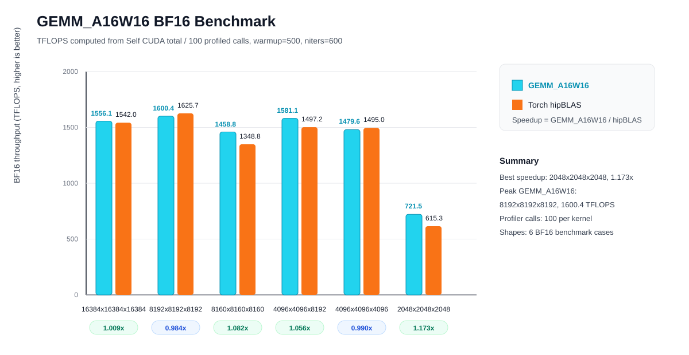

# FlyDSL GEMM Examples

Unofficial, hardware-oriented GEMM implementations built with
[FlyDSL](https://github.com/ROCm/FlyDSL) for AMD gfx950 and gfx1250 GPUs.

This repository demonstrates how to write high-performance GPU kernels from
scratch in Python while keeping tiling, data movement, LDS usage, scheduling,
and MFMA execution explicit. The programming model is similar in spirit
to CUDA/CuTeDSL, but targets AMD GPUs through FlyDSL.



## Highlights

### A16W16 GEMM

`kernels/gemm_a16w16_gfx950.py` provides a layout-dynamic FP16/BF16 GEMM with:

- `NN`, `NT`, `TN`, and `TT` matrix layouts
- FP16 and BF16 inputs
- Input-dtype or FP32 output
- Optional bias
- Workgroup-local slice-K via `k_waves`
- Cross-workgroup split-K with atomic reduction
- K-tail and boundary-tile handling
- Small-M configurations
- Half-tile interleaved (HTI) scheduling
- Dynamic leading strides, padded strides, and storage offsets
- Configurable tiles, stages, wave decomposition, and XCD block swizzle

HTI currently requires `stages=2`, `m_waves=2`, and `k_waves=1`.
Inputs and dimensions must satisfy the kernel's vector-alignment constraints.

### gfx1250: TDM GEMM

`kernels/gemm_a16w16_tdm_gfx1250.py` implements multi-stage TDM loads and
wave32 WMMA, based on
[PeakGemm's TDM kernel](https://github.com/xytpai/PeakGemm/blob/3d2a481/include/peak_gemm/kernel/hgemm_tdm_gfx1250.hpp).

- FP16/BF16 inputs, FP32 accumulation and input-dtype output.
- `NN` and `NT` layouts, M/N boundary tiles, and aligned padded strides and
  storage offsets. A/C are row-major; B follows the selected layout.
- Optional contiguous `[N]` bias, added after rounding the product to the
  output dtype.
- Configurable tiles, stages, wave counts, block ordering and optional NT
  interleaved scheduling.
- Cluster split-K via `split_k=1..9`. The default reduction sums
  input-dtype partials in FP32. `split_k_atomic=True` uses packed BF16
  atomics instead; it requires split-K and even N, rounds each update, and
  can produce different results depending on arrival order.
- A separate `gemm_fp8_ptpc_gfx1250` entry point accepts FP8 E4M3 inputs,
  FP32 row/column scales, and optional BF16 bias; output is BF16.
- Optional output buffer and stream; graph capture/replay after warmup.

Pointers and leading strides must be 16-byte aligned, and output must not
overlap inputs. K must be divisible by `split_k * block_k`, with at least
`stages - 1` K tiles per split. Tiles must satisfy WMMA divisibility and
fit the 320 KiB LDS budget; the entry points validate these constraints.

```python
import torch
from kernels.gemm_a16w16_tdm_gfx1250 import gemm_a16w16_gfx1250

a = torch.randn((8192, 8192), device="cuda", dtype=torch.bfloat16)
b = torch.randn((8192, 8192), device="cuda", dtype=torch.bfloat16).t()
c = gemm_a16w16_gfx1250(a, b, layout="nt")
```

Direct calls use explicit/default configuration parameters. Use
[policy tuning](#policy-tuning) to search FP16/BF16 configurations for a shape.

## Layout Convention

Layout characters describe physical tensor strides without changing logical
shapes:

- `N`: row-major storage
- `T`: column-major storage

For example, `layout="nt"` expects logical shapes `A[M, K]` and `B[K, N]`,
with A stored row-major and B stored column-major.

## Quick Start

```python
import torch

from kernels.gemm_a16w16_gfx950 import gemm_a16w16

m, n, k = 2048, 4096, 4096
a = torch.randn((m, k), device="cuda", dtype=torch.bfloat16)
b = torch.randn((n, k), device="cuda", dtype=torch.bfloat16).t()

c = gemm_a16w16(
    a,
    b,
    layout="nt",
    user_kwargs={
        "block_m": 128,
        "block_n": 256,
        "block_k": 64,
        "stages": 3,
        "split_k": 1,
        "m_waves": 4,
        "n_waves": 4,
        "k_waves": 1,
        "group_m": 4,
        "use_half_tile_interleaved": False,
    },
)
```

## Requirements

- Linux with ROCm
- AMD gfx950 GPU for the original GEMM, or gfx1250 for the TDM example
- ROCm-enabled PyTorch
- FlyDSL built from source

## Install FlyDSL from Source

The revision below is for the original gfx950 example. The gfx1250 path
requires a FlyDSL build with gfx1250 WMMA, TDM
(`rocdl.cdna5.make_tiled_tdm_atom`), and cluster support; this older revision
has not been validated for that path.

```bash
pip uninstall -y flydsl
git clone git@github.com:ROCm/FlyDSL.git
cd FlyDSL
git checkout b33938b00ed444f9719805f910f094a4d1858cbf
git submodule sync
git submodule update --init --recursive
bash scripts/build_llvm.sh -j32
bash scripts/build.sh -j64
pip install -e .
```

## Tests

Run the suite for your GPU architecture:

```bash
pytest -sv test_gemm_a16w16_gfx950.py       # gfx950
pytest -sv test_gemm_a16w16_tdm_gfx1250.py   # gfx1250
```

Run a focused layout test:

```bash
pytest -sv test_gemm_a16w16_gfx950.py -k "main_loop and nt"
```

Run the gfx1250 benchmark cases through pytest:

```bash
pytest -sv test_gemm_a16w16_tdm_gfx1250.py -k benchmark_smoke
```

After changing FlyDSL compiler or kernel sources, clear the JIT cache when
needed:

```bash
rm -rf ~/.flydsl/cache
```

## Policy Tuning

Tune one shape (`gemm_tune.py` selects the kernel for the detected GPU):

```bash
python gemm_tune.py \
  --single \
  --dtype bf16 \
  --layout nt \
  --m 2048 \
  --n 4096 \
  --k 4096
```

Include split-K policies:

```bash
python gemm_tune.py \
  --single \
  --dtype bf16 \
  --layout nt \
  --m 32 \
  --n 384 \
  --k 7168 \
  --enable-split-k
```

Tune the built-in shape collection:

```bash
python gemm_tune.py \
  --tune_all \
  --dtype bf16 \
  --layout nt \
  --out temp/gemm_a16w16_tuned
```

The tuner validates policies, compiles them in parallel, and benchmarks
successful candidates. `--single` prints the selected configuration;
`--tune_all` writes configurations to `<out>.jsonl`. Use `--compile-workers`
to control policy compilation concurrency. On gfx1250, tuning supports
FP16/BF16 with `NN` or `NT` layouts; `--enable-split-k` includes cluster
sizes 2 through 9 subject to configuration validity.

## PyTorch Backend Comparison

Compare ATen/hipBLAS, Triton, and FlyDSL through `torch.compile`:

```bash
python torch_benchmark.py \
  --backend all \
  --dtype bfloat16 \
  --output temp/torch_benchmark.jsonl
```

Use `--shape-index` to run a single built-in shape.

## Repository Structure

```text
kernels/
  gemm_a16w16_gfx950.py         # gfx950 A16W16 GEMM
  gemm_a16w16_gfx950_utils.py   # Layout, LDS, split-K, and store helpers
  gemm_a16w16_tdm_gfx1250.py    # gfx1250 TDM/WMMA GEMM
test_gemm_a16w16_gfx950.py      # gfx950 correctness and benchmarks
test_gemm_a16w16_tdm_gfx1250.py # gfx1250 correctness and benchmarks
gemm_tune.py                   # Policy search and tuning
torch_benchmark.py             # torch.compile backend comparison
```

## References

- [FlyDSL](https://github.com/ROCm/FlyDSL)
- [MLIR documentation](https://mlir.llvm.org/docs/)
- [ROCm blog: Accelerating LLM inference on AMD GPUs with low-latency GEMMs](https://rocm.blogs.amd.com/software-tools-optimization/accelerating-llm-inference-on-amd-gpus-with-low-latency-gemms/README.html)

Contact: xytpai@gmail.com
