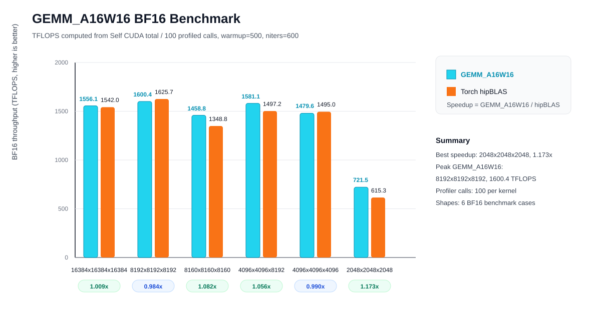

# FlyDSL GEMM Examples

Unofficial, hardware-oriented GEMM implementations built with
[FlyDSL](https://github.com/ROCm/FlyDSL) for AMD gfx950 and gfx1250 GPUs.

This repository demonstrates how to write high-performance GPU kernels from
scratch in Python while keeping tiling, data movement, LDS usage, scheduling,
and MFMA execution explicit. The programming model is similar in spirit
to CUDA/CuTeDSL, but targets AMD GPUs through FlyDSL.



## Highlights

### A16W16 GEMM

`kernels/gemm_a16w16_gfx950.py` provides a layout-dynamic FP16/BF16 GEMM with:

- `NN`, `NT`, `TN`, and `TT` matrix layouts
- FP16 and BF16 inputs
- Input-dtype or FP32 output
- Optional bias
- Workgroup-local slice-K via `k_waves`
- Cross-workgroup split-K with atomic reduction
- K-tail and boundary-tile handling
- Small-M configurations
- Half-tile interleaved (HTI) scheduling
- Dynamic leading strides, padded strides, and storage offsets
- Configurable tiles, stages, wave decomposition, and XCD block swizzle

HTI currently requires `stages=2`, `m_waves=2`, and `k_waves=1`.
Inputs and dimensions must satisfy the kernel's vector-alignment constraints.


### gfx1250: PeakGemm multi-stage TDM GEMM

**BF16 8192³ follow-up:** the no-spill implementation already measured
**2.84–2.87 PFLOPS in short bursts** on two f01 GPUs. Under sustained load,
PPT limiting reduced GFX clock to about 1.5 GHz and throughput to 2.21–2.24
PFLOPS; C++ PeakGemm showed the same effect. See the
[ISA/ATT and power-state analysis](docs/gfx1250_bf16_analysis.md).
Use `--mode both --dtype bf16 --json bf16_phases.json` to report burst and
sustained results separately; the default legacy timing remains unchanged.


`kernels/gemm_a16w16_tdm_gfx1250.py` is a small port of
[PeakGemm's TDM kernel](https://github.com/xytpai/PeakGemm/blob/3d2a481/include/peak_gemm/kernel/hgemm_tdm_gfx1250.hpp).
It keeps the same pipeline structure:

1. Prefetch `stages - 1` tiles into a padded LDS ring.
2. Wait for the oldest A/B tile, issue the next two TDM loads, then run
   wave32 `16x16x32` WMMA. The main loop handles two K tiles per iteration.
3. Drain outstanding tiles and reuse LDS for coalesced output stores.

Each wave copies disjoint rows. A workgroup barrier after the TDM wait makes
the whole tile visible and prevents recycling LDS while another wave reads it.
The entry point exposes tile sizes, wave counts and stage count directly;
there is no automatic tuning or dispatch to another GEMM implementation.

```python
import torch
from kernels.gemm_a16w16_tdm_gfx1250 import gemm_a16w16

a = torch.randn((8192, 8192), device="cuda", dtype=torch.float16)
b = torch.randn((8192, 8192), device="cuda", dtype=torch.float16).t()
c = gemm_a16w16(a, b)  # tile=256x256x128, waves=4x4, stages=2

# A deeper pipeline needs a smaller K tile to fit in LDS.
c = gemm_a16w16(a, b, block_k=64, stages=4)
```

First-version contract:

- FP16/BF16 inputs, FP32 accumulation, input-dtype output.
- Logical `A[M,K] @ B[K,N]`; A/C contiguous and B a transposed contiguous
  `[N,K]` tensor (NT layout). Pointers must be 16-byte aligned.
- Optional contiguous `[N]` bias, **added after rounding the accumulator to
  the output dtype**, matching PeakGemm.
- Full tiles only: M/N/K divisible by block sizes, with at least `stages - 1`
  K tiles. No split-K, boundary masking, or arbitrary strides.
- Padded A/B buffers and output shuffle share at most 320 KiB of LDS.
  For example, `256x256x128` fits 2 stages, but not 3.
- Optional `out`, `group_m` block ordering and `stream`; graph capture/replay
  is supported after warmup. Output must not overlap any input.

Run correctness tests and a graph-based benchmark:

```bash
pytest -q test_gemm_a16w16_tdm_gfx1250.py

python test_gemm_a16w16_tdm_gfx1250.py --mnk 8192 8192 8192
python test_gemm_a16w16_tdm_gfx1250.py --mnk 8192 8192 8192 --tile 256 256 64 --stages 2 3 4
```

Measured on f01 gfx1250 with FlyDSL 0.4.1, 2026-11-02, M=N=K=8192,
4x4 waves, no bias. These are median GPU-event times from 9 HIP graph replays,
each containing 20 GEMM launches; compilation, allocations and reference
computation are excluded. This is one measurement run, not an autotuning result.

| Tile | Stages | FP16 TFLOPS | BF16 TFLOPS |
|---|---:|---:|---:|
| 256x256x128 | 2 | 2523.68 | 2357.00 |
| 256x256x64 | 2 | 2311.21 | 2237.56 |
| 256x256x64 | 3 | 2391.39 | 2302.37 |
| 256x256x64 | 4 | 2413.68 | 2364.64 |

At fixed BK=64, deeper staging helps this shape. More stages do not always
win: BK=128 with 2 stages remains faster for FP16 in this run.

**Follow-up: avoid register spills in the K remainder.** The initial port's
optional last-main-tile `if` was lowered to a predicated region that kept old
and new accumulator sets live. With the default tile, that used 256 VGPRs
and 484 bytes of scratch per thread. A zero-or-one-trip loop keeps the
accumulators loop-carried instead: 212 VGPRs, no spills and no scratch for
both FP16 and BF16, without changing the pipeline math or supported shapes.

A separate GPU1 run (8192 cubed, default tile, same inputs, 41 randomized
paired rounds, 20 launches per HIP graph) measured:

| Dtype | Initial FlyDSL TFLOPS | No-spill FlyDSL TFLOPS | PeakGemm C++ TFLOPS |
|---|---:|---:|---:|
| FP16 | 2174.17 | 2358.10 | 2402.00 |
| BF16 | 2144.97 | 2328.93 | 2370.97 |

All 105 correctness tests passed. BF16 improved by 8.6% in that run.
These follow-up numbers are a paired comparison on GPU1, not directly
comparable to the earlier absolute numbers above. In particular, the
same-run C++ baseline also did not reach 2.5 PFLOPS.


## Layout Convention

Layout characters describe physical tensor strides without changing logical
shapes:

- `N`: row-major storage
- `T`: column-major storage

For example, `layout="nt"` expects logical shapes `A[M, K]` and `B[K, N]`,
with A stored row-major and B stored column-major.

## Quick Start

```python
import torch

from kernels.gemm_a16w16_gfx950 import gemm_a16w16

m, n, k = 2048, 4096, 4096
a = torch.randn((m, k), device="cuda", dtype=torch.bfloat16)
b = torch.randn((n, k), device="cuda", dtype=torch.bfloat16).t()

c = gemm_a16w16(
    a,
    b,
    layout="nt",
    user_kwargs={
        "block_m": 128,
        "block_n": 256,
        "block_k": 64,
        "stages": 3,
        "split_k": 1,
        "m_waves": 4,
        "n_waves": 4,
        "k_waves": 1,
        "group_m": 4,
        "use_half_tile_interleaved": False,
    },
)
```

## Requirements

- Linux with ROCm
- AMD gfx950 GPU for the original GEMM, or gfx1250 for the TDM example
- ROCm-enabled PyTorch
- FlyDSL built from source

## Install FlyDSL from Source

The original gfx950 example uses the following revision. The gfx1250 TDM
example was tested separately with FlyDSL 0.4.1 and requires gfx1250 WMMA plus
`rocdl.cdna5.make_tiled_tdm_atom` support. The older revision below has not
been validated for that new path:

```bash
pip uninstall -y flydsl
git clone git@github.com:ROCm/FlyDSL.git
cd FlyDSL
git checkout b33938b00ed444f9719805f910f094a4d1858cbf
git submodule sync
git submodule update --init --recursive
bash scripts/build_llvm.sh -j32
bash scripts/build.sh -j64
pip install -e .
```

## Tests

Run the GEMM correctness suite:

```bash
pytest -sv test_gemm_a16w16_gfx950.py
```

Run a focused layout test:

```bash
pytest -sv test_gemm_a16w16_gfx950.py -k "main_loop and nt"
```

After changing FlyDSL compiler or kernel sources, clear the JIT cache when
needed:

```bash
rm -rf ~/.flydsl/cache
```

## Policy Tuning

Tune one shape:

```bash
python gemm_tune.py \
  --single \
  --dtype bf16 \
  --layout nt \
  --m 2048 \
  --n 4096 \
  --k 4096
```

Include split-K policies:

```bash
python gemm_tune.py \
  --single \
  --dtype bf16 \
  --layout nt \
  --m 32 \
  --n 384 \
  --k 7168 \
  --enable-split-k
```

Tune the built-in shape collection:

```bash
python gemm_tune.py \
  --tune_all \
  --dtype bf16 \
  --layout nt \
  --out temp/gemm_a16w16_tuned
```

The tuner validates each policy, compiles policies in parallel, benchmarks
successful candidates, and writes the selected configurations to JSONL.
Use `--compile-workers` to control policy compilation concurrency.

## PyTorch Backend Comparison

Compare ATen/hipBLAS, Triton, and FlyDSL through `torch.compile`:

```bash
python torch_benchmark.py \
  --backend all \
  --dtype bfloat16 \
  --output temp/torch_benchmark.jsonl
```

Use `--shape-index` to run a single built-in shape.

## Repository Structure

```text
kernels/
  gemm_a16w16_gfx950.py        # A16W16 GEMM
  gemm_a16w16_gfx950_utils.py  # Layout, LDS, split-K, and store helpers
test_gemm_a16w16_gfx950.py     # GEMM correctness and benchmarks
gemm_tune.py                    # Policy search and tuning
torch_benchmark.py              # torch.compile backend comparison
```

## References

- [FlyDSL](https://github.com/ROCm/FlyDSL)
- [MLIR documentation](https://mlir.llvm.org/docs/)
- [ROCm blog: Accelerating LLM inference on AMD GPUs with low-latency GEMMs](https://rocm.blogs.amd.com/software-tools-optimization/accelerating-llm-inference-on-amd-gpus-with-low-latency-gemms/README.html)

Contact: xytpai@gmail.com
